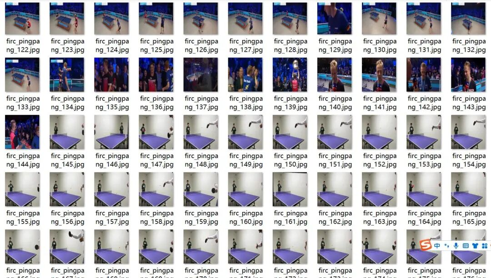
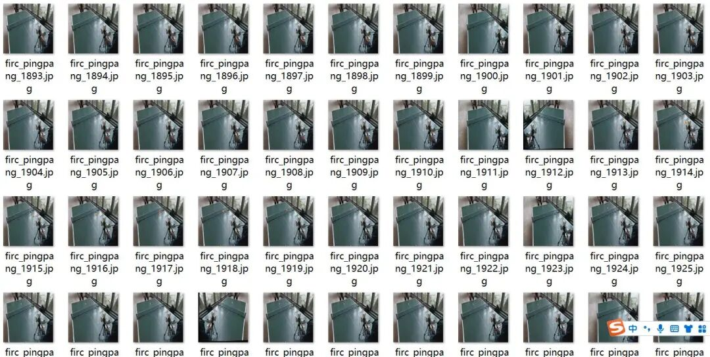
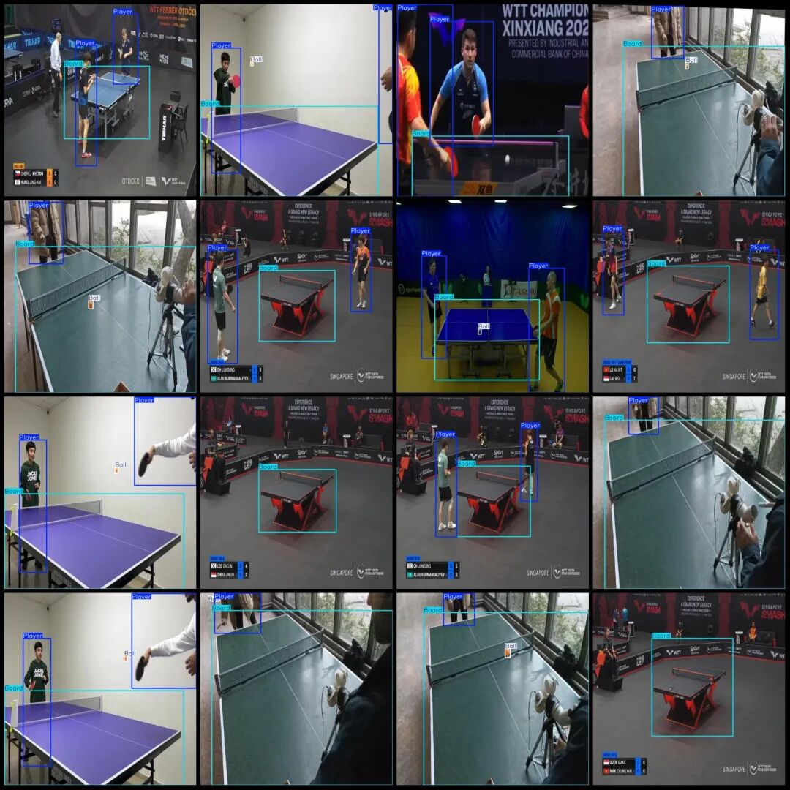

# Table Tennis Elements Detection Player Table Table Table Tennis Dataset VOC+YOLO format 2721 images 3 categories

Note: Some of the images in the dataset have been enhanced.

Dataset format: Pascal VOC format + YOLO format (txt file without split path, only containing jpg images and corresponding VOC format xml files and yolo format txt files)

Number of images (number of jpg files): 2721

Number of annotations (number of xml files): 2721

Number of annotations (number of txt files): 2721

Label category count: 3

Label category names (note that the order of yolo format categories does not correspond to this, but is based on the classes.txt in the labels folder): ["Ball", "Board", "Player"]

Number of boxes labeled in each category:

Ball Frames = 1710

Board Frames = 2657

Player Frames = 3738

Total frame count: 8105

Image resolution: 640x640

Using labelImg:

Annotation rules: Draw a rectangle around the category.

Important Notice: No

Special : This dataset does not guarantee the accuracy of the trained models or weight files.

Image Preview:

Annotation examples (randomly select 16 images to show the annotation situation):

## Payment

Here is a pay link on Stripe ( https://buy.stripe.com/3cs8yP7sY87d0vu9AB ). Please contact me lonlonago@foxmail.com after funding $89, and I will send you a complete data files , thank you!

